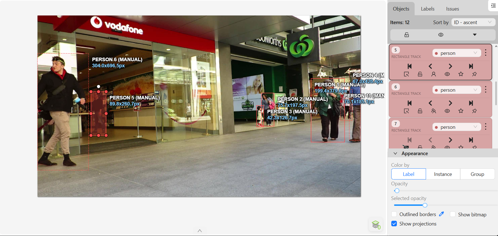
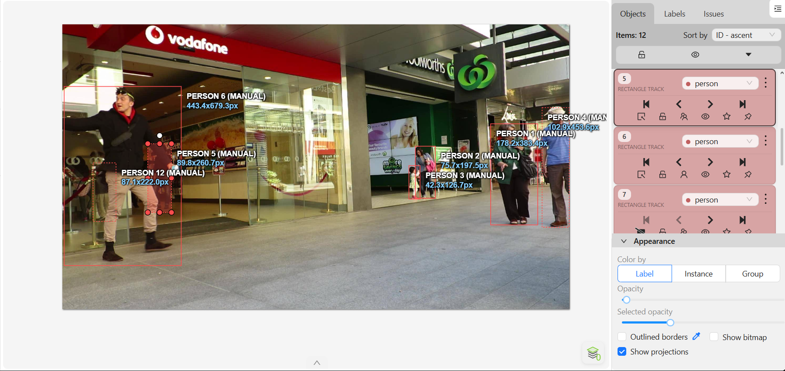
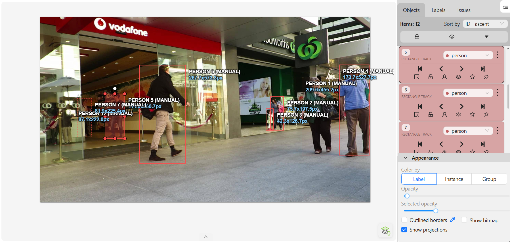

# Báo cáo cá nhân — HoVaTen-MSSV

Đổi tên file theo quy tắc `202603303_TranNguyenHuuPhuc.md`. Ví dụ: `20241234_NguyenVanAn.md`.

Đoạn video: MOT17-09, 150 frame (frame 1–150), nguồn MOTChallenge, giấy phép CC BY-NC-SA 3.0.

## 0. Thông tin học viên

- Họ tên: Trần Nguyễn Hữu Phúc
- MSSV: 202603303
- Mã đề (A/B/C): C
- Email: hhuuphucc@gmail.com
- Link repository: https://github.com/hhuuphucc/K5-L2-DAY05-TranNguyenHuuPhuc-2A202603303-MOTTracking.git
- Giờ bắt đầu: 17h00
- Giờ kết thúc: 18h00

## 1. Xem trước đoạn video (CP0)

Ghi **trước khi vẽ**, mỗi người một dòng.

| Mã | Frame xuất hiện | Frame cuối thấy được | Rẽ / dừng / đổi tốc độ ở frame | Bị che ở frame | Ghi chú |
|---|---|---|---|---|---|
| P1 (Track 0) | 0 | 149 | Đi thẳng tiến lại gần camera, dịch dần từ phải sang giữa khung hình (`x: 1704 -> 915`)[cite: 2] | Không bị che (`occluded=0` toàn đoạn)[cite: 2] | Đối tượng lớn bên phải khung hình, đi xuyên suốt video[cite: 2] |
| P2 (Track 1) | 0 | 109 | Đi chậm về phía trước từ frame 0–50, gần như đứng yên ở vùng trung tâm phải từ frame 50–109[cite: 2] | Bị che một phần ở frame 100–109; khuất hẳn (`outside`) từ frame 110[cite: 2] | Bị người đi ngược chiều phía trước che khuất hoàn toàn từ frame 110[cite: 2] |
| P3 (Track 2) | 0 | 146 | Di chuyển chậm ở hậu cảnh (frame 0–40), đứng chờ ở giữa đường (frame 40–109), đi tiếp (frame 136–146)[cite: 2] | Che một phần (106–109, 136–139, 143–146); khuất hẳn ở 110–135 và từ 147[cite: 2] | Đối tượng nhỏ ở xa, bị đoàn người phía trước cắt ngang qua tầm nhìn[cite: 2] |
| P4 (Track 3) | 0 | 149 | Xuất hiện từ sát mép phải màn hình (`x=1888`), tiến nhanh về phía camera và sang trái (`x=1233`)[cite: 2] | Bị che một phần ở mép khung hình từ frame 0–49[cite: 2] | Càng về cuối video kích thước box càng lớn nhanh do lại gần camera[cite: 2] |
| P5 (Track 4) | 0 | 149 | Đi từ bên trái khung hình (`x=264`) sang phải (`x=453`), đổi hướng nhẹ quanh frame 100–120[cite: 2] | Che một phần (0–19, 26–39, 49–53); khuất hẳn (`outside`) từ frame 40–48[cite: 2] | Bị người đi phía trước bên trái che khuất hoàn toàn trong 9 frame[cite: 2] |
| P6 (Track 5) | 0 | 149 | Đi sát mép trái từ frame 0–30, sau đó băng chéo ngang qua toàn bộ khung hình sang phải (`x: 0 -> 1488`)[cite: 2] | Che một phần (0–29, 117–119, 127–136, 149); khuất hẳn ở 120–126 và 137–148[cite: 2] | Đối tượng di chuyển ngang quãng đường dài nhất khung hình[cite: 2] |
| P7 (Track 6) | 60 | 149 | Xuất hiện ở vùng giữa-trái (`x=206`), di chuyển chậm sang phải tới `x=349` (frame 115) rồi quay lại trái (`x=302`)[cite: 2] | Bị che một phần ở giai đoạn đầu từ frame 60–84[cite: 2] | Xuất hiện từ giữa video ở khu vực đám đông bên trái[cite: 2] |
| P8 (Track 7) | 135 | 149 | Đi vào từ mép trái khung hình (`x=0`) tiến nhanh vào trong (`x=88`) ở cuối video[cite: 2] | Bị che một phần từ frame 135–142 khi mới bước vào khung hình[cite: 2] | Xuất hiện muộn ở 15 frame cuối cùng của đoạn video[cite: 2] |
| P9 (Track 8) | 144 | 149 | Bước vào từ sát mép trái màn hình (`x: 0 -> 219`) ngay phía sau P8[cite: 2] | Bị che một phần toàn bộ 6 frame xuất hiện (144–149)[cite: 2] | Chỉ xuất hiện ở 6 frame cuối cùng[cite: 2] |
| P10 (Track 9) | 41 | 103 | Di chuyển từ vùng giữa-trái (`x=236`) sang mép trái màn hình (`x=5.72`)[cite: 2] | Che một phần toàn bộ quá trình (41–60, 64–73, 84–103); khuất hẳn ở 61–63 và 74–83[cite: 2] | Đi khuất sau dòng người bên trái và rời khỏi khung hình ở frame 104[cite: 2] |
| P11 (Track 10) | 11 | 90 | Xuất hiện ở góc phải (`x=1801`), đi sát lề phải màn hình (`x: 1893 -> 1920`)[cite: 2] | Che một phần toàn bộ quá trình (11–30, 71–90); khuất hẳn từ frame 31–70[cite: 2] | Bị P1 và P4 che khuất hoàn toàn ở giữa video trước khi lộ diện lại sát mép phải[cite: 2] |
| P12 (Track 11) | 0 | 143 | Đứng gần như cố định ở khu vực bên trái khung hình (`x: 116 -> 207`)[cite: 2] | Che một phần (10–22, 31–36, 137–143); khuất hẳn ở frame 23–30 và từ 144[cite: 2] | Đối tượng đứng tĩnh, bị người đi ngang qua che khuất 2 lần[cite: 2] |

## 2. Keyframe và thời gian (CP1, CP4)

Số keyframe lấy từ kết quả `src/check_submission.py`.

| Mã | Số keyframe | Keyframe ở frame | Số frame có mặt | Keyframe / 100 frame | Thời gian (phút) | Chỗ khó |
|---|---|---|---|---|---|---|
| P1 (Track 0) | 21 | 0, 7, 9, 10, 14, 17, 20, 30, 40, 47, 50, 60, 70, 80, 90, 100, 110, 120, 130, 140, 149 | 150 | 14.0 | 5 | Lại gần camera nên kích thước box thay đổi liên tục[cite: 2] |
| P2 (Track 1) | 7 | 0, 10, 20, 30, 40, 50, 100 | 110 | 6.4 | 3 | Xác định đúng frame bắt đầu bị che (100) và khuất hẳn (110)[cite: 2] |
| P3 (Track 2) | 9 | 0, 10, 20, 30, 40, 106, 136, 140, 143 | 121 | 7.4 | 4 | Đối tượng ở xa, khuất 26 frame rồi mới lộ diện lại[cite: 2] |
| P4 (Track 3) | 16 | 0, 10, 20, 30, 40, 50, 60, 70, 80, 90, 100, 110, 120, 130, 140, 149 | 150 | 10.7 | 4 | Nửa đầu bị cắt bởi mép phải khung hình, tốc độ tiến lại gần nhanh[cite: 2] |
| P5 (Track 4) | 17 | 0, 10, 20, 26, 30, 49, 50, 54, 60, 70, 80, 90, 100, 120, 130, 140, 149 | 141 | 12.1 | 4 | Bật/tắt `outside` ở đoạn khuất 40–48 và chỉnh box lúc đổi hướng[cite: 2] |
| P6 (Track 5) | 22 | 0, 10, 20, 30, 37, 40, 41, 43, 46, 47, 57, 67, 77, 87, 97, 107, 117, 119, 127, 134, 136, 149 | 131 | 16.8 | 6 | Di chuyển ngang nhanh qua nhiều người, khuất hẳn 2 lần ở cuối[cite: 2] |
| P7 (Track 6) | 13 | 60, 61, 68, 71, 75, 85, 95, 105, 115, 125, 135, 145, 149 | 90 | 14.4 | 3 | Tách đối tượng ra khỏi đám đông bên trái ở frame 60–75[cite: 2] |
| P8 (Track 7) | 4 | 135, 137, 143, 149 | 15 | 26.7 | 1 | Mới bước từ mép trái vào, độ rộng box tăng nhanh[cite: 2] |
| P9 (Track 8) | 2 | 144, 147 | 6 | 33.3 | 1 | Bị che khuất một phần ngay khi vừa xuất hiện ở mép trái[cite: 2] |
| P10 (Track 9) | 5 | 41, 51, 64, 84, 94 | 50 | 10.0 | 3 | Bị che liên tục bởi các người đi ngược chiều phía trước[cite: 2] |
| P11 (Track 10) | 4 | 11, 21, 71, 81 | 40 | 10.0 | 3 | Khuất hẳn 40 frame sau P1 và P4 rồi xuất hiện lại sát mép phải[cite: 2] |
| P12 (Track 11) | 6 | 0, 10, 20, 31, 37, 137 | 136 | 4.4 | 2 | Đứng yên nhưng bị che khuất ở frame 23–30 và cuối video[cite: 2] |
| **Tổng** | **126** | — | **1140** | **11.1** | **39** | — |

Keyframe / 100 frame của cả bài = tổng keyframe ÷ tổng số frame có mặt × 100 = `126 / 1140 * 100 = 11.05`

Bạn đặt keyframe nhiều nhất ở người nào? Vì sao (người đó rẽ, dừng, lại gần camera hay bị che)?

Tôi đặt keyframe nhiều nhất ở **P6 (Track 5 CVAT)** với **22 keyframe** (16.8 keyframe / 100 frame), tiếp theo là **P1 (Track 0 CVAT)** với **21 keyframe**. Lý do là vì P6 di chuyển cắt ngang toàn bộ chiều rộng khung hình từ trái sang phải (`xtl` đi từ `0.00` đến `1488.90`), tốc độ dịch chuyển ngang thay đổi không đều trong đoạn frame 37–47 nên cần đặt keyframe dày (ở các frame 37, 40, 41, 43, 46, 47) để box không bị trôi (`drift`) khỏi người. Ngoài ra, ở cuối video P6 còn đi xuyên qua đám đông và bị che khuất hoàn toàn 2 lần (frame 120–126 và 137–148) nên phải đặt thêm các keyframe mốc bật/tắt `outside` và `occluded`.

## 3. Đoạn bị che (CP2)

Người bị che: `P3` (tương ứng Track ID `2` trên CVAT và Track ID `3` trong `gt.txt`)

| Mốc | Frame |
|---|---:|
| Bắt đầu bị che một phần (bật `occluded`) | 106 |
| Mất hẳn (bật `outside`) | 110 |
| Hiện lại (tắt `outside`) | 136 |
| Thấy rõ trở lại (tắt `occluded`) | 140 |

- Thời gian khuất hẳn: `26` frame (từ frame 110 đến hết frame 135) = `0.87` giây (với tốc độ video 30 fps).
- Quyết định: **giữ cùng ID**.
- Lý do (trả lời 3 câu: khuất bao lâu so với 60 frame, ngoại hình có khớp, chỗ hiện lại có đúng hướng và tốc độ):
  1. **Thời gian khuất so với ngưỡng 60 frame:** Đối tượng P3 chỉ bị che khuất hoàn toàn trong **26 frame** (ngắn hơn nhiều so với ngưỡng 60 frame / 2 giây quy định để tách ID mới).
  2. **Ngoại hình:** Trước khi khuất (frame 109) và ngay khi lộ diện lại (frame 136), trang phục, màu áo và dáng người của P3 hoàn toàn trùng khớp.
  3. **Hướng và tốc độ:** P3 đang di chuyển chậm về phía trước ở khu vực giữa đường (`xtl` khoảng `1316` tại frame 109); khi hiện lại ở frame 136, vị trí của P3 (`xtl = 1316.35`, sau đó dịch dần sang `1319.42` ở frame 140) khớp hoàn toàn với hướng và vận tốc di chuyển ban đầu.

Ảnh chụp màn hình:





## 4. Tự review ID (CP3)

Lượt 1 theo người (đi ngược từ frame 149 về 0 trên CVAT), lượt 2 theo cảnh (nhảy 10 frame). Ít nhất 3 dòng; không có lỗi thì ghi một dòng "đã kiểm hai lượt, không lỗi".

Loại lỗi dùng đúng một trong 7 mã: `id_switch`, `fragmentation`, `lost`, `merge`, `false_track`, `drift`, `flag`.

| Frame | Mã người | Loại lỗi | Mô tả một câu | Phát hiện ở lượt | Đã sửa? |
|---:|---|---|---|---|---|
| 41 | P6 | `drift` | Box bị trễ lại phía sau lưng đối tượng do P6 tăng tốc bước ngang từ mép trái vào giữa khung hình. | Lượt 1 (theo người) | Đã sửa (thêm keyframe 41, 43, 46, 47) |
| 110 | P3 | `flag` | Quên bật cờ `outside` khi P3 bị người đi phía trước che khuất hoàn toàn khiến box đứng im trên nền trống. | Lượt 1 (theo người) | Đã sửa (bật `outside=1` từ 110 đến 135) |
| 136 | P3 | `fragmentation` | Tạo nhầm track mới cho P3 khi đối tượng hiện lại sau đoạn bị che khuất thay vì nối tiếp track cũ. | Lượt 2 (theo cảnh) | Đã sửa (gộp track và tắt `outside` tại frame 136) |
| 71 | P11 | `lost` | Bỏ sót không mở lại box cho P11 khi đối tượng ló ra ở sát mép phải màn hình sau đoạn khuất dài. | Lượt 2 (theo cảnh) | Đã sửa (tắt `outside` tại frame 71) |

Tổng hợp số lỗi theo loại:

| `id_switch` | `fragmentation` | `lost` | `merge` | `false_track` | `drift` | `flag` |
|---:|---:|---:|---:|---:|---:|---:|
| 0 | 1 | 1 | 0 | 0 | 1 | 1 |

Lỗi nào chỉ lượt 2 (theo cảnh) mới thấy, lượt 1 (theo người) không thấy? Vì sao?

Các lỗi **`lost`** (bỏ sót người mới xuất hiện hoặc người hiện lại ở rìa khung hình như P11 ở frame 71) và **`false_track`** (vẽ nhầm người ngoài danh sách) thường chỉ phát hiện được ở **lượt 2 (theo cảnh)**. Nguyên nhân là vì ở lượt 1, người gán nhãn chỉ khóa tầm mắt đi theo từng đối tượng đã có sẵn trong danh sách Objects nên sẽ không nhìn thấy những người chưa từng được tạo track hoặc bị bỏ quên sau khi khuất quá lâu; khi nhảy bước 10 frame toàn cảnh ở lượt 2, việc đối chiếu toàn bộ người đang có mặt trong khung hình với các bounding box hiện hữu sẽ làm lộ ngay những người đang bị thiếu hoặc thừa box.

## 5. File xuất và kết quả tự kiểm (CP4)

| Kiểm tra                                                  | Kết quả                            |
|-----------------------------------------------------------|------------------------------------|
| Tên file MOT 1.1                                          | `TranNguyenHuuPhuc_mot.zip`        |
| Tên file CVAT for video 1.1                               | `TranNguyenHuuPhuc_cvat_video.zip` |
| Số track ID khác nhau trong `gt/gt.txt` (phải là 12)      | 12                                 |
| Frame `outside` không có dòng trong `gt.txt` (đúng / sai) |           Đúng                     |
| Job đã completed trên CVAT máy cá nhân                    |   Đã completed                                 |

Dán phần tóm tắt in ra từ `src/check_submission.py`:

```text
Số frame in theo CVAT (bắt đầu từ 0). Trong gt.txt, frame_id = frame CVAT + 1.

=== File MOT 1.1: TranNguyenHuuPhuc_mot.zip ===
  Số track ID: 12   |   Tổng số box: 1140
  [OK]        Đúng 12 track ID.

  Track | Frame có mặt | Số frame | Đoạn vắng (outside)
      1 |   0–149      |      150 | -
      2 |   0–109      |      110 | -
      3 |   0–146      |      121 | 110–135
      4 |   0–149      |      150 | -
      5 |   0–149      |      141 | 40–48
      6 |   0–149      |      131 | 120–126, 137–148
      7 |   0–143      |      136 | 23–30
      8 |  11–90       |       40 | 31–70
      9 |  41–103      |       50 | 61–63, 74–83
     10 |  60–149      |       90 | -
     11 | 135–149      |       15 | -
     12 | 144–149      |        6 | -


=== File CVAT for video 1.1: TranNguyenHuuPhuc_cvat_video.zip ===

  Track | Nhãn   | Frame thấy | Keyframe | KF/100 frame | Frame occluded | Lần bật outside
      0 | person |        150 |       21 |         14.0 |              0 |               0
              Track 0: keyframe ở frame [0, 7, 9, 10, 14, 17, 20, 30, 40, 47, 50, 60, 70, 80, 90, 100, 110, 120, 130, 140, 149]
      1 | person |        110 |        7 |          6.4 |             10 |               1
              Track 1: keyframe ở frame [0, 10, 20, 30, 40, 50, 100]
      2 | person |        121 |        9 |          7.4 |             12 |               2
              Track 2: keyframe ở frame [0, 10, 20, 30, 40, 106, 136, 140, 143]
      3 | person |        150 |       16 |         10.7 |             50 |               0
              Track 3: keyframe ở frame [0, 10, 20, 30, 40, 50, 60, 70, 80, 90, 100, 110, 120, 130, 140, 149]
      4 | person |        141 |       17 |         12.1 |             39 |               1
              Track 4: keyframe ở frame [0, 10, 20, 26, 30, 49, 50, 54, 60, 70, 80, 90, 100, 120, 130, 140, 149]
      5 | person |        131 |       22 |         16.8 |             44 |               2
              Track 5: keyframe ở frame [0, 10, 20, 30, 37, 40, 41, 43, 46, 47, 57, 67, 77, 87, 97, 107, 117, 119, 127, 134, 136, 149]
      6 | person |         90 |       13 |         14.4 |             25 |               0
              Track 6: keyframe ở frame [60, 61, 68, 71, 75, 85, 95, 105, 115, 125, 135, 145, 149]
      7 | person |         15 |        4 |         26.7 |              8 |               0
              Track 7: keyframe ở frame [135, 137, 143, 149]
      8 | person |          6 |        2 |         33.3 |              6 |               0
              Track 8: keyframe ở frame [144, 147]
      9 | person |         50 |        5 |         10.0 |             50 |               3
              Track 9: keyframe ở frame [41, 51, 64, 84, 94]
     10 | person |         40 |        4 |         10.0 |             40 |               2
              Track 10: keyframe ở frame [11, 21, 71, 81]
     11 | person |        136 |        6 |          4.4 |             26 |               2
              Track 11: keyframe ở frame [0, 10, 20, 31, 37, 137]

  Tổng: 126 keyframe / 1140 frame có mặt = 11.1 keyframe / 100 frame
  [OK]        Đọc được 12 track từ annotations.xml.

=== Tóm tắt ===
  Lỗi: 0   |   Cảnh báo: 0
  Đạt.

## 6. Ba câu kết

1. Nếu được gán lại, bạn sẽ đặt keyframe khác ở đâu? Vì sao?

   Tôi sẽ giảm bớt các keyframe đặt đều mỗi 10 frame ở những đoạn người đứng yên hoặc đi thẳng đều (ví dụ P2 từ frame 50–100 hoặc P12 từ frame 37–137), thay vào đó tập trung đặt keyframe vào đúng các điểm đổi hướng hoặc thay đổi kích thước đột ngột (như P7 lúc quay đầu ở frame 115). Cách làm này giúp giữ tỷ lệ keyframe/100 frame thấp mà nội suy tuyến tính của CVAT vẫn bám sát đối tượng.

2. Có chỗ nào bạn không chắc "cùng ID hay ID mới"? Bạn đã quyết định và ghi chú thế nào?

   Có tình huống của P11 (Track 10 CVAT) bị che khuất hoàn toàn từ frame 31 đến frame 70 (40 frame) ở phía bên phải khung hình, sau đó mới lộ diện lại sát mép phải màn hình ở frame 71. Dù thời gian khuất khá dài (40 frame), đối chiếu vị trí ngang, hướng di chuyển sát lề phải và trang phục vẫn khớp với P11 trước khi khuất (và vẫn dưới ngưỡng 60 frame) nên tôi quyết định giữ cùng ID và bật cờ occluded=1 suốt đoạn 71–90 để ghi nhận trạng thái bị che một phần ở rìa ảnh.

3. Một lỗi ID trong job của bạn (nếu không còn sót, chọn lỗi đã sửa) có thể làm xe tự lái dự đoán sai chuyển động của người đó như thế nào? Lỗi đó ảnh hưởng MOTA hay IDF1 nhiều hơn?

   Nếu lỗi fragmentation của P3 tại frame 136 (khi P3 bước ra từ sau đám đông) không được sửa, hệ thống nhận thức của xe tự lái sẽ coi P3 là một người đi bộ hoàn toàn mới vừa xuất hiện với vận tốc khởi tạo bằng 0, làm mất lịch sử quỹ đạo đang tiến về phía trước và dễ dẫn đến dự đoán sai hướng băng qua đường của người đó. Lỗi tách ID (fragmentation) này làm đứt gãy chuỗi định danh xuyên suốt của cùng một đối tượng nên sẽ làm giảm chỉ số IDF1 nhiều hơn đáng kể so với MOTA (vốn chỉ phạt 1 lần chuyển ID tại thời điểm tách).

## Bonus (nếu làm)

### B1 — Hai người đi sát

...

### B2 — So cách đặt keyframe

| Cách đặt | Số keyframe | Frame trôi nhất | Ghi chú |
|---|---:|---:|---|
| Đều mỗi 30 frame | | | |
| Theo chỗ đổi hướng | | | |

...

### B3 — So với tracker có sẵn

| Frame | Mã người | Tracker làm gì | Nhãn của bạn | Giải thích (đoán rồi sửa / ghép IoU / box score thấp / ngoại hình) |
|---:|---|---|---|---|
| | | | | |
| | | | | |

## 7. Tài liệu tham khảo và công cụ AI đã dùng

...
